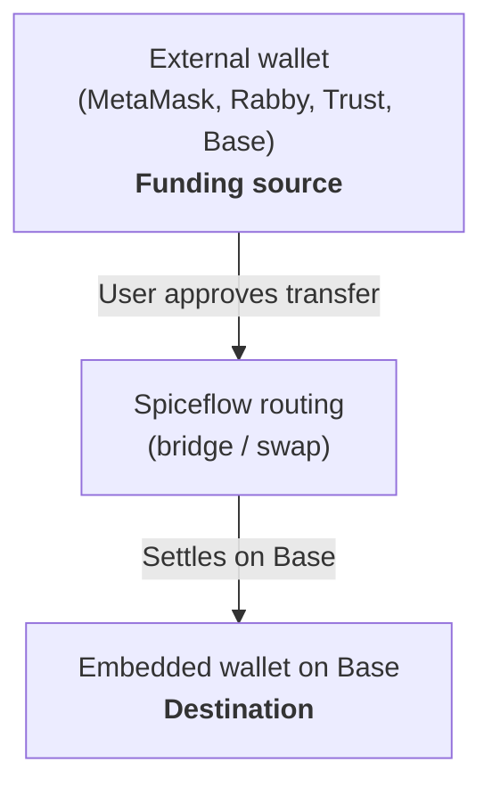

# Spiceflow Cross-Chain Deposit — Integration Guide

[](https://www.typescriptlang.org/)
[](LICENSE)

Let users fund an in-app (embedded) wallet on Base from any external EVM wallet they already use (MetaMask, Rabby, Trust, Base Wallet…), across multiple chains, without leaving your app.

---

## Table of Contents

1. [How It Works](#1-how-it-works)
2. [Install](#2-install)
3. [Environment](#3-environment)
4. [File Structure](#4-file-structure)
5. [Implementation](#5-implementation)
6. [Wallet Hydration (Read This)](#6-wallet-hydration-read-this)
7. [Supported Chains & Assets](#7-supported-chains--assets)
8. [RPC Proxy Pattern](#8-rpc-proxy-pattern)
9. [Troubleshooting](#9-troubleshooting)
10. [License](#10-license)

---

## 1. How It Works



| Role | What it does | Address |
| :--- | :--- | :--- |
| **Funding wallet** | Holds the user's assets on any supported chain and signs the transfer | External wallet |
| **Destination wallet** | Receives the final token on Base | Embedded wallet |
| **Spiceflow SDK** | Scans balances, quotes routes, builds the transaction | — |

**Modes**

- `ondemand` — an external wallet is present; its assets are scanned and used as the source.
- `7702` — embedded wallet only; external assets are **not** scanned.

---

## 2. Install

```bash
npm install @spicenet-io/spiceflow-ui@^4.18.2 @spicenet-io/spiceflow-core@^0.8.0 \
  @privy-io/react-auth viem wagmi @tanstack/react-query buffer
```

**Buffer polyfill (Vite).** Add at the very top of `main.tsx`, before any SDK import:

```ts
import { Buffer } from "buffer";
if (typeof window !== "undefined") (window as any).Buffer ??= Buffer;
```

---

## 3. Environment

Copy `.env.example` to `.env` and fill in:

```bash
VITE_PRIVY_APP_ID=your_privy_app_id
VITE_SPICEFLOW_APP_ID=your_spiceflow_app_id
VITE_RPC_URL_1=https://eth-mainnet.g.alchemy.com/v2/your_key
VITE_RPC_URL_8453=https://base-mainnet.g.alchemy.com/v2/your_key
VITE_RPC_URL_42161=https://arb-mainnet.g.alchemy.com/v2/your_key
```

Never commit `.env`.

---

## 4. File Structure

```text
src/
├── config/spiceflow.ts                 # destination token, chains, allowed assets
├── hooks/useFundingWallet.ts           # resolves external (source) + embedded (destination)
├── providers/SpiceFlowProviderWrapper.tsx  # SDK provider, mode, RPC overrides
└── components/SpiceDepositModal.tsx    # deposit window
```

All four files are included in this repository under `src/`.

---

## 5. Implementation

### Step 1 — Config
See [`src/config/spiceflow.ts`](src/config/spiceflow.ts). Set your destination token address and the assets to scan per chain.

### Step 2 — Funding wallet hook
See [`src/hooks/useFundingWallet.ts`](src/hooks/useFundingWallet.ts). Separates the external wallet (source) from the embedded wallet (destination) and waits briefly for the external wallet to appear.

### Step 3 — Provider
See [`src/providers/SpiceFlowProviderWrapper.tsx`](src/providers/SpiceFlowProviderWrapper.tsx). Chooses `ondemand` when an external wallet exists, otherwise `7702`, and passes your own RPC URLs.

### Step 4 — Deposit modal
See [`src/components/SpiceDepositModal.tsx`](src/components/SpiceDepositModal.tsx). Renders `SpiceSupply` with the embedded wallet as recipient and external assets enabled.

### Wire it up

```tsx
<PrivyProvider appId={import.meta.env.VITE_PRIVY_APP_ID}>
  <QueryClientProvider client={queryClient}>
    <SpiceFlowProviderWrapper>
      <App />
    </SpiceFlowProviderWrapper>
  </QueryClientProvider>
</PrivyProvider>
```

---

## 6. Wallet Hydration (Read This)

> ⚠️ **The 3.5-second wait is a fallback, not a guarantee.**
>
> It gives the external wallet time to appear after page load. It does **not** prove restoration finished. On slow phones or in-app wallet browsers the wallet can appear later — or not at all until the user reconnects.

**Why it happens**

1. In-app wallet browsers inject their provider after the page loads.
2. On session restore, the embedded wallet comes back instantly; the external one can lag.
3. If you decide too early, the app switches to `7702` and only scans the empty embedded wallet — the user sees "no assets".

**Safeguards to add**

1. **Keep listening after the timeout.** If the external wallet shows up later, switch back to `ondemand` and rescan.
2. **Check `user.linkedAccounts`.** If a wallet is linked but missing from `useWallets()`, show "Reconnecting wallet…" instead of "no assets".
3. **Silent check only.** Use `eth_accounts` (no popup). Never call `eth_requestAccounts` just to read balances.
4. **Give a reconnect button.** "Don't see your wallet? Reconnect" → calls Privy `connectWallet()`.
5. **Never revoke on sign-out.** Call Privy `logout()` only. Do not send `wallet_revokePermissions` — some wallets (e.g. Rabby) honour it and the external wallet stops restoring.

If a user is stuck: sign out and sign in again.

---

## 7. Supported Chains & Assets

| Network | Chain ID | Assets scanned |
| :--- | :--- | :--- |
| Ethereum | 1 | USDC, USDT, WBTC, ETH |
| BNB Chain | 56 | USDC, USDT |
| Polygon | 137 | USDC, USDT |
| Base | 8453 | USDC, USDT, ETH, cbETH |
| Arbitrum | 42161 | USDC, USDT, WBTC, ETH, ARB |
| Robinhood Chain | set per your SDK | USDG, ETH |

Assets show only when balance > 0.

---

## 8. RPC Proxy Pattern

Public RPCs often return **HTTP 200 with an error inside the body**. Treat that as a failure and try the next endpoint:

```ts
export async function forwardRpc(body: unknown, endpoints: string[]) {
  for (const url of endpoints) {
    try {
      const res = await fetch(url, {
        method: "POST",
        headers: { "Content-Type": "application/json" },
        body: JSON.stringify(body),
        signal: AbortSignal.timeout(8000),
      });
      if (!res.ok) continue;
      const data = await res.json();
      // code 3 = contract revert: a real answer, return it
      if (data?.error && data.error.code !== 3) continue;
      return data;
    } catch {
      /* try next */
    }
  }
  throw new Error("All RPC endpoints failed");
}
```

---

## 9. Troubleshooting

| Symptom | Likely cause | Fix |
| :--- | :--- | :--- |
| External assets missing | Mode fell back to `7702` | Confirm external wallet detected; add safeguards in §6 |
| Works for some users only | Session restored without external wallet | User signs out/in; add reconnect button |
| Popup on every deposit | Using `eth_requestAccounts` to read | Use `eth_accounts` |
| `Buffer is not defined` | Missing polyfill | See §2 |
| Quotes hang / partial balances | RPC rate limits or hidden errors | Own RPC URLs + proxy in §8 |

---

## 10. License

[MIT](LICENSE)
