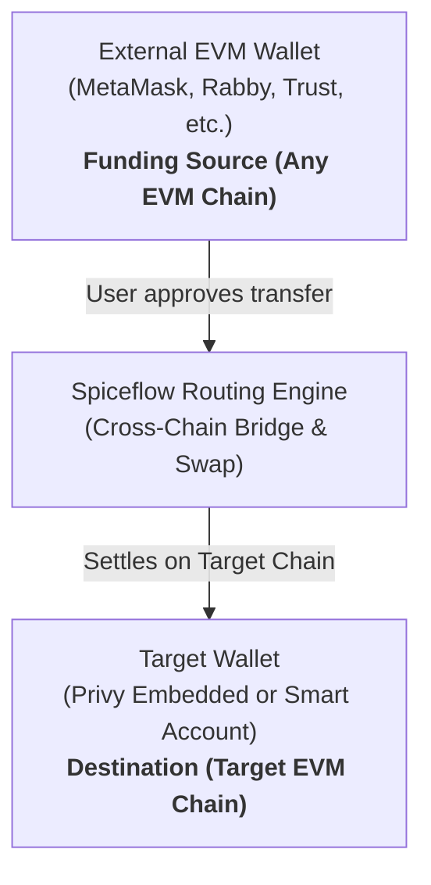

# Spiceflow Cross-Chain Deposit — Universal EVM Integration Guide

[](https://www.typescriptlang.org/)
[](LICENSE)

A developer guide and production reference for integrating **Spiceflow** cross-chain deposits into any EVM decentralized application.

Allow users to fund an in-app (embedded) or recipient wallet on **any target EVM chain** using assets from their existing external wallets (MetaMask, Rabby, Trust, Coinbase/Base Wallet, etc.) across multiple source networks—without leaving your application.

> 💡 **Production Specimen Note:**  
> This guide is chain-agnostic and applies to **any EVM chain** supported by Spiceflow (Arbitrum, Base, Optimism, Polygon, Ethereum, BNB Chain, etc.). Concrete code examples in `src/` use our live **Base (Chain ID 8453)** deployment as the reference specimen. To target another network, simply update `DESTINATION_CHAIN_ID` and your token address in [`src/config/spiceflow.ts`](src/config/spiceflow.ts).

---

## Table of Contents

1. [How It Works](#1-how-it-works)
2. [Install](#2-install)
3. [Environment Configuration](#3-environment-configuration)
4. [File Structure](#4-file-structure)
5. [Implementation Steps](#5-implementation-steps)
6. [Wallet Hydration Safeguards (Critical)](#6-wallet-hydration-safeguards-critical)
7. [Supported Chains & Filtered Assets](#7-supported-chains--filtered-assets)
8. [RPC Proxy Pattern](#8-rpc-proxy-pattern)
9. [Troubleshooting Matrix](#9-troubleshooting-matrix)
10. [License](#10-license)

---

## 1. How It Works



| Role | Responsibility | Typical Account |
| :--- | :--- | :--- |
| **Funding Wallet (Source)** | Holds the user's funds across external networks; signs the transfer transaction | External injected or mobile wallet |
| **Routing Engine** | Quotes best swap + bridge routes across EVM chains | Spiceflow SDK |
| **Destination Wallet** | Receives the finalized token on your target EVM chain | Privy Embedded Wallet or user account |

### Operational Modes

- **`ondemand`** — Active when an external wallet is detected. Spiceflow scans balances on the external wallet across all configured chains and sets it as the deposit source.
- **`7702`** — Active when only an embedded wallet is present. External wallet assets are **not** scanned.

---

## 2. Install

Install the core dependencies:

```bash
npm install @spicenet-io/spiceflow-ui@^4.18.2 @spicenet-io/spiceflow-core@^0.8.0 \
  @privy-io/react-auth viem wagmi @tanstack/react-query buffer
```

### Buffer Polyfill (Vite / Next.js)

Vite does not bundle Node's `Buffer`. Add this at the very top of your entry point (`main.tsx` or `index.tsx`), before importing any SDK modules:

```ts
import { Buffer } from "buffer";
if (typeof window !== "undefined") {
  (window as any).Buffer ??= Buffer;
}
```

---

## 3. Environment Configuration

Copy `.env.example` to `.env` and fill in your app keys and dedicated RPC URLs:

```bash
# Privy App ID
VITE_PRIVY_APP_ID=your_privy_app_id

# Spiceflow App ID
VITE_SPICEFLOW_APP_ID=your_spiceflow_app_id

# Dedicated RPC URLs for source and target EVM networks (e.g. Alchemy, Infura, QuickNode)
VITE_RPC_URL_1=https://eth-mainnet.g.alchemy.com/v2/your_key
VITE_RPC_URL_10=https://opt-mainnet.g.alchemy.com/v2/your_key
VITE_RPC_URL_56=https://bsc-dataseed.binance.org/
VITE_RPC_URL_137=https://polygon-mainnet.g.alchemy.com/v2/your_key
VITE_RPC_URL_8453=https://base-mainnet.g.alchemy.com/v2/your_key
VITE_RPC_URL_42161=https://arb-mainnet.g.alchemy.com/v2/your_key
```

*Never commit `.env` to version control.*

---

## 4. File Structure

```text
src/
├── config/
│   └── spiceflow.ts                 # Target chain, destination token, allowed assets
├── hooks/
│   └── useFundingWallet.ts          # Distinguishes source (external) vs destination (embedded)
├── providers/
│   └── SpiceFlowProviderWrapper.tsx # SDK provider with dynamic mode & RPC overrides
└── components/
    └── SpiceDepositModal.tsx        # UI modal rendering the SpiceSupply component
```

All source files are included in the `src/` folder of this repository.

---

## 5. Implementation Steps

### Step 1: Target Chain & Token Configuration

Configure your target chain and receiving token in [`src/config/spiceflow.ts`](src/config/spiceflow.ts):

```ts
// Target EVM Chain ID (Specimen: 8453 for Base. Can be 42161 for Arbitrum, 10 for Optimism, etc.)
export const DESTINATION_CHAIN_ID = 8453;

export const SPICEFLOW_CONFIG = {
  network: "mainnet" as const,
  nativeChainId: DESTINATION_CHAIN_ID,
  destinationToken: {
    chainId: DESTINATION_CHAIN_ID,
    address: "0xYourTokenAddressOnTargetChain" as `0x${string}`,
    symbol: "TOKEN",
    decimals: 18,
  },
};
```

### Step 2: Funding Wallet Detection Hook

In [`src/hooks/useFundingWallet.ts`](src/hooks/useFundingWallet.ts), inspect Privy's connected wallets to separate the funding source from the in-app destination:

```ts
import { useEffect, useState } from "react";
import { usePrivy, useWallets } from "@privy-io/react-auth";

export function useFundingWallet() {
  const { authenticated, user } = usePrivy();
  const { wallets } = useWallets();
  const [waiting, setWaiting] = useState(true);

  const embedded = wallets.find((w) => w.walletClientType === "privy");
  const external = wallets.find((w) => w.walletClientType !== "privy");

  const linkedExternal = user?.linkedAccounts?.some(
    (a: any) => a.type === "wallet" && a.walletClientType !== "privy",
  );

  useEffect(() => {
    if (!authenticated || external) {
      setWaiting(false);
      return;
    }
    setWaiting(true);
    const t = setTimeout(() => setWaiting(false), 3500);
    return () => clearTimeout(t);
  }, [authenticated, external]);

  return {
    externalAddress: (external?.address ?? null) as `0x${string}` | null,
    embeddedAddress: (embedded?.address ?? null) as `0x${string}` | null,
    isHydrating: waiting,
    isExternalAvailable: Boolean(external),
    needsReconnect: !waiting && !external && Boolean(linkedExternal),
  };
}
```

### Step 3: Provider Setup

Wrap your application in [`src/providers/SpiceFlowProviderWrapper.tsx`](src/providers/SpiceFlowProviderWrapper.tsx) to supply dedicated RPCs and select `ondemand` vs `7702`:

```tsx
import type { ReactNode } from "react";
import { SpiceFlowProvider } from "@spicenet-io/spiceflow-ui";
import { useFundingWallet } from "../hooks/useFundingWallet";

export function SpiceFlowProviderWrapper({ children }: { children: ReactNode }) {
  const { isExternalAvailable } = useFundingWallet();
  const mode = isExternalAvailable ? "ondemand" : "7702";

  return (
    <SpiceFlowProvider
      appId={import.meta.env.VITE_SPICEFLOW_APP_ID}
      mode={mode}
      rpcUrls={{
        1: import.meta.env.VITE_RPC_URL_1,
        10: import.meta.env.VITE_RPC_URL_10,
        56: import.meta.env.VITE_RPC_URL_56,
        137: import.meta.env.VITE_RPC_URL_137,
        8453: import.meta.env.VITE_RPC_URL_8453,
        42161: import.meta.env.VITE_RPC_URL_42161,
      }}
    >
      {children}
    </SpiceFlowProvider>
  );
}
```

### Step 4: Deposit Window Component

Render `SpiceSupply` in [`src/components/SpiceDepositModal.tsx`](src/components/SpiceDepositModal.tsx):

```tsx
<SpiceSupply
  destinationToken={SPICEFLOW_CONFIG.destinationToken}
  recipientAddress={embeddedAddress ?? undefined}
  includeExternalWalletAssets={Boolean(externalAddress)}
  onSuccess={onClose}
/>
```

---

## 6. Wallet Hydration Safeguards (Critical)

> ⚠️ **The 3.5-second timeout is a fallback heuristic, not a guarantee.**
>
> It accommodates mobile wallet browsers (Rabby, Trust, MetaMask mobile) where injected providers initialize asynchronously after DOM load. It does not guarantee wallet restoration has finished.

### Why Hydration Delays Occur

1. **Asynchronous Injection:** Mobile wallet in-app browsers often inject their Ethereum provider several seconds after the page has rendered.
2. **Session Desync:** On page reload, Privy restores the embedded wallet from storage almost instantly, while the external wallet adapter requires an async handshake.
3. **Premature Mode Collapse:** If your app evaluates wallet state too quickly, it falls back to `7702` (embedded-only mode), leaving external balances un-scanned.

### Essential Production Safeguards

1. **Continuous State Listening:** Even after the 3.5s timeout expires, keep listening to `wallets`. When the external wallet appears, automatically re-enable `ondemand` mode.
2. **Linked Account Fallback:** Check `user.linkedAccounts`. If an external wallet is linked to the user's account but absent from `wallets`, present a "Reconnecting wallet…" status rather than showing empty balances.
3. **Silent Provider Checks:** Read accounts using `eth_accounts` rather than `eth_requestAccounts` to prevent unwanted popup prompts on load.
4. **Manual Reconnect Escape Hatch:** Provide a visible "Don't see your external wallet? Reconnect" button that invokes `connectWallet()`.
5. **Clean Sign-Out:** On user logout, call Privy `logout()`. Do **not** issue `wallet_revokePermissions`, as strict wallets (e.g. Rabby) will refuse automatic re-connection on subsequent visits.

---

## 7. Supported Chains & Filtered Assets

Filtering scanned assets dramatically speeds up balance queries and eliminates spam tokens:

| Network | Chain ID | Recommended Curated Assets |
| :--- | :--- | :--- |
| **Ethereum** | 1 | USDC, USDT, WBTC, ETH |
| **Optimism** | 10 | USDC, USDT, ETH, OP |
| **BNB Chain** | 56 | USDC, USDT |
| **Polygon** | 137 | USDC, USDT |
| **Base (Specimen)** | 8453 | USDC, USDT, ETH, cbETH |
| **Arbitrum One** | 42161 | USDC, USDT, WBTC, ETH, ARB |

---

## 8. RPC Proxy Pattern

Public RPC endpoints frequently return **HTTP 200 with JSON-RPC error payloads** when rate-limited. In production, proxy RPC calls through a resilient handler:

```ts
export async function forwardRpc(body: unknown, endpoints: string[]) {
  for (const url of endpoints) {
    try {
      const res = await fetch(url, {
        method: "POST",
        headers: { "Content-Type": "application/json" },
        body: JSON.stringify(body),
        signal: AbortSignal.timeout(8000),
      });
      if (!res.ok) continue;
      const data = await res.json();
      // Contract execution reverts (error code 3) are valid responses
      if (data?.error && data.error.code !== 3) continue;
      return data;
    } catch {
      // Endpoint timed out or threw; try next fallback
    }
  }
  throw new Error("All RPC endpoints failed");
}
```

---

## 9. Troubleshooting Matrix

| Symptom | Probable Cause | Recommended Fix |
| :--- | :--- | :--- |
| **External wallet assets not listed** | Mode collapsed into `7702` (embedded-only) | Ensure `includeExternalWalletAssets={true}` and apply hydration safeguards in §6 |
| **Works on desktop, fails in mobile wallet** | Asynchronous provider injection delay | Increase grace period or display manual reconnect button |
| **Wallet prompt triggers on page load** | Called `eth_requestAccounts` instead of `eth_accounts` | Use silent account detection |
| **`Buffer is not defined` error** | Missing polyfill in Vite build | Add Buffer polyfill at top of entry point (see §2) |
| **Slow or hanging quote generation** | Public RPC rate limiting or hidden errors | Configure dedicated RPC URLs with failover proxy (see §8) |

---

## 10. License

[MIT](LICENSE)
